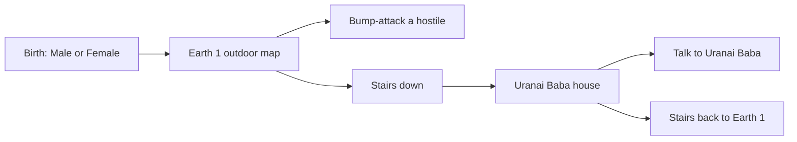

# Dragonball T on ToME 4: playable slice

Status: done. The module is in [te4/dbt](dbt). Played on Tales of Maj'Eyal 1.7.6: walk the outdoor map, kill hostiles, and take the stairs into the house.

Dragonball T in this repo is a ToME 2 / T-Engine 3 total conversion ([DBT/module.lua](../DBT/module.lua), alpha 18, version 0.9.1). ToME 4 1.7.6 is a different engine ([module guide](https://te4.org/wiki/T4_Modules_Howto_Guide)). Lua from `DBT/` will not load there. This pass adds a new module written for engine `te4-1.7.6`. [DBT/](../DBT/) remains the content source. `.tome/3.0/modules/dbt/` is a runtime copy and is not edited.

The engine itself is not vendored. The module is Lua that runs inside a local [Tales of Maj'Eyal 1.7.6](https://te4.org/download) install. `init.lua` sets `engine = {1,7,6,"te4"}`, which resolves to the installed `te4-1.7.6` package. The example module's `{1,1,5,"te4"}` field does not load on that install.

## What the slice plays like

- Birth matches [DBT/data/player/descriptors.lua](../DBT/data/player/descriptors.lua): gender only. PlayTest mode waits.
- Start on a small outdoor map in the Earth 1 / Dragonworld style of [DBT/data/maps/earth1.map](../DBT/data/maps/earth1.map) and [DBT/data/wild/terrain.lua](../DBT/data/wild/terrain.lua): grass, trees, road, water, a building, and a stair into Uranai Baba's house (`DUNGEON_URANAI` is the `a` entrance on that map). The full wilderness and the full earth1 ASCII map stay for a later pass.
- Melee uses the engine's normal bump-to-attack. DBT's custom combat, chi, enrollment, hunger, and technomancy stay in the ToME 3 scripts.
- One dungeon floor: the static house from [DBT/data/maps/uranai.map](../DBT/data/maps/uranai.map) (walls, door, floor, up-stair). Swamp generator levels and the tentacle-demon quest stay out.
- One NPC: Uranai Baba, neutral, with a short greeting taken from the opening of `dialogue.URANAI_BABA` in [DBT/scripts/dialogue.lua](../DBT/scripts/dialogue.lua). Quest branches stay out.
- Starter kit echoes the ToME 3 birth kit: street clothes and a kubotan, plus a short in-game note that this is the ToME 4 slice.

## Module layout

Tree: `te4/dbt/`, copied into `<ToME 1.7.6>/game/modules/dbt` to run. Skeleton follows the official example module ([getting started](https://te4.org/wiki/T4_Modules_Howto_Guide/Getting_Started)).

- `init.lua`: name `Dragonball T`, `short_name = "dbt"`, version `1.0.0` for this port, `show_only_on_cheat` off, `no_funfacts` on.
- `load.lua` plus `class/Game.lua` and `class/Player.lua`: new game starts on the Earth 1 zone.
- `data/birth/descriptors.lua`: base body and Male / Female.
- `data/zones/earth1/`: static ASCII zone, a few hostile melee NPCs, down-stair.
- `data/zones/uranai/`: static house map, up-stair, Uranai Baba.
- `data/chats/uranai-baba.lua`: greeting and goodbye.
- `data/general/grids`, `objects`, `npcs`: floors, walls, door, clothes, kubotan, thug or wild animal.
- ASCII only, so no tile art is required.

[te4/dbt/README.md](dbt/README.md) says how to copy the folder and launch `t-engine.exe -Mdbt -uTester -n`.

## Check

With 1.7.6 installed: new game, pick a gender, spawn on Earth 1, hit a hostile, take the stair, talk to Baba, return upstairs, save and load.

Played on the local 1.7.6 install. Walking, killing, and the stairs into the house all worked. A scripted pass also confirmed female birth gear, melee damage, Baba's greeting, the return to the road, and a save that loaded.
